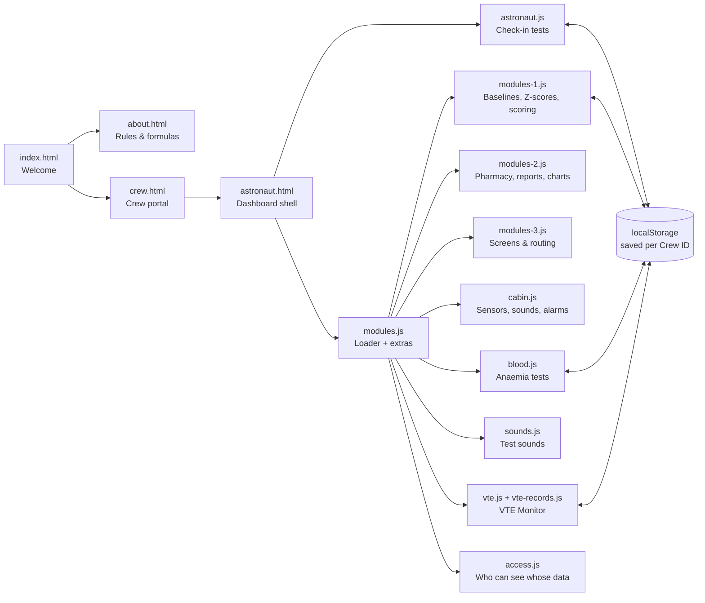
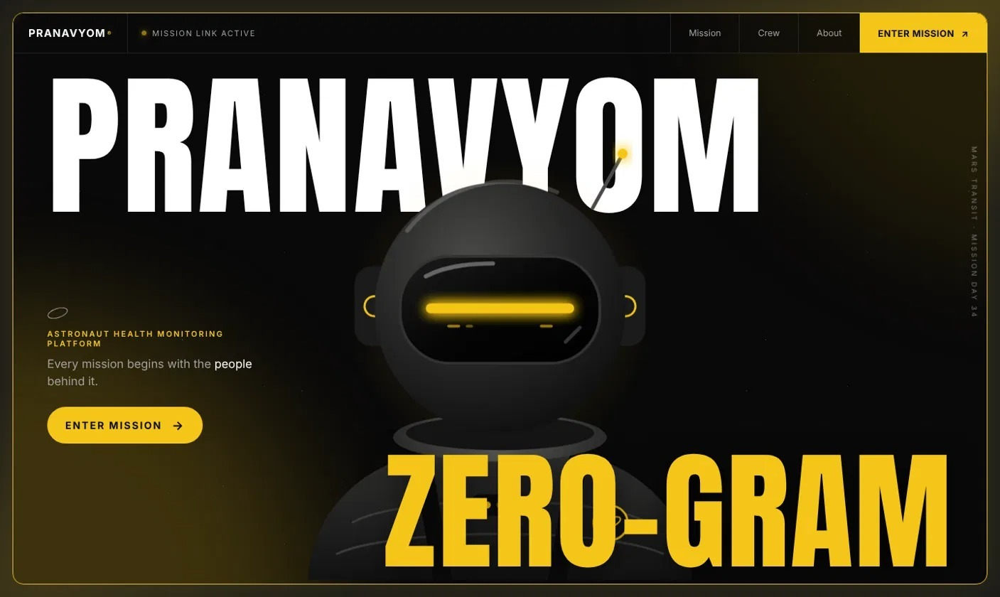
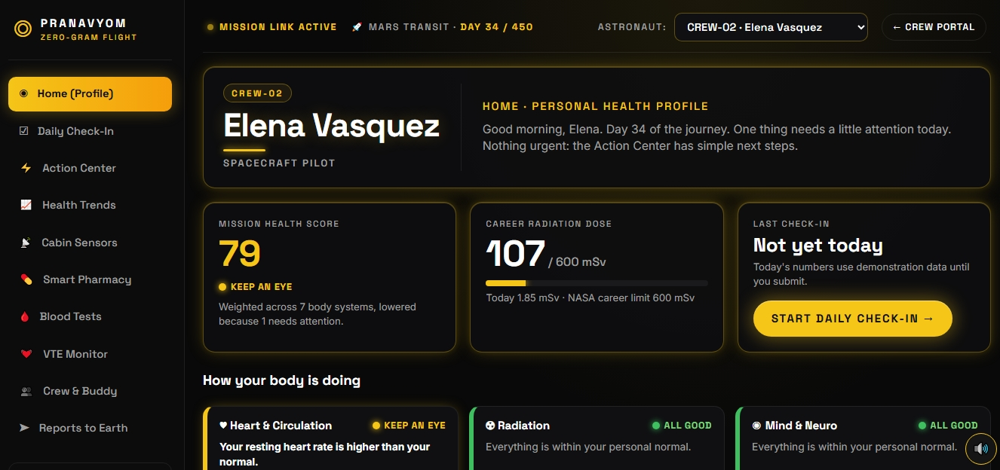
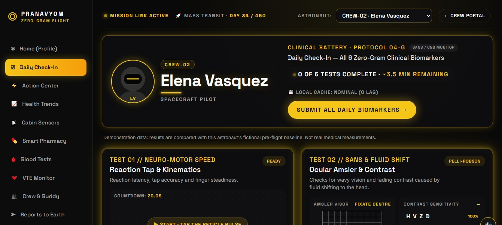

# Pranavyom Zero Health Check
# PRANAVYOM ZERO-GRAM

### 🔴 Live demo: **https://aryan1912-sudo.github.io/Pranavyom/**

A daily health companion for astronauts on a long Mars mission. It turns a tablet into a 3–4 minute check-in, compares every result with that astronaut's own normal, and explains what to do in plain words, without waiting for a doctor on Earth.

> All astronauts, sensor readings, blood and VTE records in this prototype are **fictional demonstration data**. It is decision support, not a medical diagnosis.

---

## 1. Project Title & Problem Statement

**Challenge:** Astronaut Health Monitoring Software

> Long missions expose astronauts to space radiation, isolation and confinement, altered gravity, and a hostile closed environment, which can bring immune changes, bone loss, cardiovascular events, and behavioral health problems. On long missions, astronauts carry much of the responsibility for spotting these changes in themselves. Your challenge is to build a health monitoring software that gathers health indicators and enables astronauts to evaluate and act on the status of their health.

**Our summary:** on a Mars mission Earth can be up to 22 minutes away by radio, so the crew cannot rely on real-time medical help. Each hazard in the challenge maps to something ZERO-GRAM monitors:

| Hazard in the challenge | What ZERO-GRAM monitors |
|---|---|
| Space radiation | Radiation dosimeter: dose rate, daily and career dose; Earth-return readiness |
| Isolation and confinement → behavioral health | Mood, stress and energy sliders, journal, sleep, anonymous buddy flag |
| Altered gravity → bone loss, eyes, clots | Grip-hold drift, ARED workouts, Amsler/contrast eye tests (SANS), hydration and kidney-stone risk, VTE Monitor |
| Cardiovascular events | Resting heart rate, blood oxygen, VTE breathlessness and chest-pain emergency flag |
| Immune changes | Symptom logging, Blood Tests (space anaemia every 30 days) |
| Hostile closed environment | Cabin CO₂ spot sensor, O₂, pressure, temperature, humidity |

**Our goal:** spot these changes early using only a tablet, compare each astronaut with their **own** baseline, and give clear, safe next steps, while keeping data on the device and sending only tiny reports to Earth.

---

## 2. Team Details

**Team name:** Vyro

| Member | Institution | GitHub | Role |
|---|---|---|---|
| Aryan Turkar | Laxminarayan Innovation Technological University, Nagpur | [@Aryan1912-sudo](https://github.com/Aryan1912-sudo) | Lead developer & integration |
| Ansh Singh | G H Raisoni College of Engineering and Management, Nagpur | [@2010singhransh-lang](https://github.com/2010singhransh-lang) | UI testing |
| Sanskruti Deshmukh | G H Raisoni College of Engineering and Management, Nagpur | [@2011deshmukhsanskruti](https://github.com/2011deshmukhsanskruti) | Research & documentation |
| Hariom Pawar | G H Raisoni College of Engineering and Management, Nagpur | [@Hariompawarx-create](https://github.com/Hariompawarx-create) | QA & deployment |

---

## 3. Solution Overview & Architecture

### What it does

| Screen | Purpose |
|---|---|
| **Welcome & About** | Mission intro and a full explanation of every rule and formula |
| **Crew portal** | Pick one of 16 fictional crew members |
| **Daily Check-in** | 6 tests: reaction tap, Amsler grid & contrast (SANS), spatial memory, grip hold & ARED workout, hydration, mood & symptoms, each with its own sound |
| **Home** | Mission health score (0–100), 7 body systems in traffic-light colours, end-of-day reminder table with buzzer |
| **Action Center** | For each problem: what we noticed, simple steps first, approved kit medicines with safety checks, when to call the Medical Officer |
| **Health Trends** | 30-day graphs with the personal normal band; health score this week vs last week vs first week |
| **Cabin Sensors** | CO₂ spot sensor (mmHg / ppm / %), O₂, pressure, temperature, humidity and radiation dosimeter (µGy/h → µSv/h, daily and career dose); solar-storm and scrubber-fault demos |
| **Smart Pharmacy** | 15 medicines: stock, radiation-adjusted expiry, run-out forecast, allergy blocks, interaction warnings |
| **Blood Tests** | Space-anaemia check every 30 days with spoken reminder; haemoglobin chart and report entry |
| **VTE Monitor** | Blood-clot symptom questionnaire every 15 days; emergency flag and simulated priority transmission to Earth; medical investigation records |
| **Crew & Buddy** | Privacy choices and an anonymous "worried about a crewmate" flag |
| **Reports to Earth** | Under-1 KB clinical brief and Earth-return readiness table |
| **Privacy** | Each crew member sees only their own health data; 4 mission officials (Commander, Medical Officer, Communications Specialist, Space Medicine Researcher) can view everyone |

### How the score works

- Each measure becomes a **Z-score** against the astronaut's own baseline: `Z = (today − personal mean) ÷ personal spread`.
- **Green** below 1.5σ, **Yellow** 1.5σ–2.5σ, **Red** 2.5σ or more, plus fixed safety limits (for example SpO₂ below 92%, CO₂ above 4 mmHg, radiation above 10 mSv/day).
- 7 body systems are weighted (Heart 20%, Radiation 20%, Mind 15%, Eyes 15%, Immune 10%, Sleep 10%, Bones & muscle 10%), then penalties and caps apply so one serious problem can never hide behind a good average (any Red → score at most 49).

### Architecture



- **No server, no build step.** Everything runs offline in the browser, which suits a spacecraft with limited bandwidth.
- `modules.js` loads the feature files one after another and shows a clear message if any file is missing.
- Data is saved in the browser's `localStorage`, separately for each Crew ID.

### Technology stack

- HTML5, CSS3, vanilla JavaScript (no frameworks, no libraries)
- Inline SVG for all charts
- Web Audio API for sounds and alarms; Speech Synthesis API for spoken reminders
- localStorage for on-device data
- GitHub Pages for hosting

---

## 4. Live Demo & Screenshots

- **Live app:** https://aryan1912-sudo.github.io/Pranavyom/
- **Demo video:** https://youtu.be/Tq9quBSzU6c

**Try this path:** Welcome → **About** → back → **Enter mission** → pick an astronaut → do the check-in → open every sidebar item. On **Cabin Sensors**, press **Solar storm** to hear the alarm.

**Privacy demo:** sign in as **CREW-05** and other crew members are locked 🔒; click **Switch user** and pick **CREW-04** (Medical Officer) to see the whole crew.

Good crew members to demo: **CREW-05** (eye changes / SANS), **CREW-06** (low blood oxygen), **CREW-13** (high radiation dose), **CREW-03** (sleep debt, anaemia).





---

## 5. Installation & Setup Guide

No installation or dependencies are needed.

```bash
git clone https://github.com/Aryan1912-sudo/Pranavyom.git
cd Pranavyom
```

Then either:

- **VS Code:** install the *Live Server* extension, right-click `index.html` → **Open with Live Server**, or
- **Python:** run `python -m http.server 5500` and open `http://127.0.0.1:5500/`

Use a local server rather than double-clicking the file, because the dashboard loads its modules with JavaScript. To reset the demo data, open the browser console and run `localStorage.clear()`.

---

## 6. AI Usage Disclosure

We used **Claude (Anthropic)** heavily, and we want to be fully transparent about it.

**What AI generated**

- **Nearly all of the code** was written by Claude from our instructions: `index.html`, `style.css`, `script.js`, `crew.html/.css/.js`, `astronaut.html/.css/.js`, `modules.js`, `modules-1.js`, `modules-2.js`, `modules-3.js`, `modules.css`, `cabin.js`, `blood.js`, `sounds.js`, `vte.js`, `vte-records.js`, `access.js` and `about.html`.
- The scoring formulas, thresholds, weights and the fictional demo data were proposed by Claude and accepted by us.
- The explanatory text on the About page and most of this README were drafted by Claude.

**What our team did**

- Chose the problem, the concept, the name and the black-and-yellow design.
- Decided every feature and wrote the requirements, including the full specification for the VTE Monitor module and the requests for cabin sensors, blood tests, sounds, reminders and crew data privacy.
- Placed every file in the project, integrated the modules, tested every screen in the browser, reported errors back (missing files, truncated pastes, wrong file names, cache problems) and verified the fixes.
- Handled all Git work, commits and GitHub Pages deployment from our own accounts.
- Reviewed the content for safety: fictional data is clearly labelled, and the app never gives a diagnosis.

**Rules we followed:** no AI tool appears as a commit author, co-author or repository contributor.

---

*PRANAVYOM ZERO-GRAM · NASA Space Apps Challenge 2026, Nagpur*
